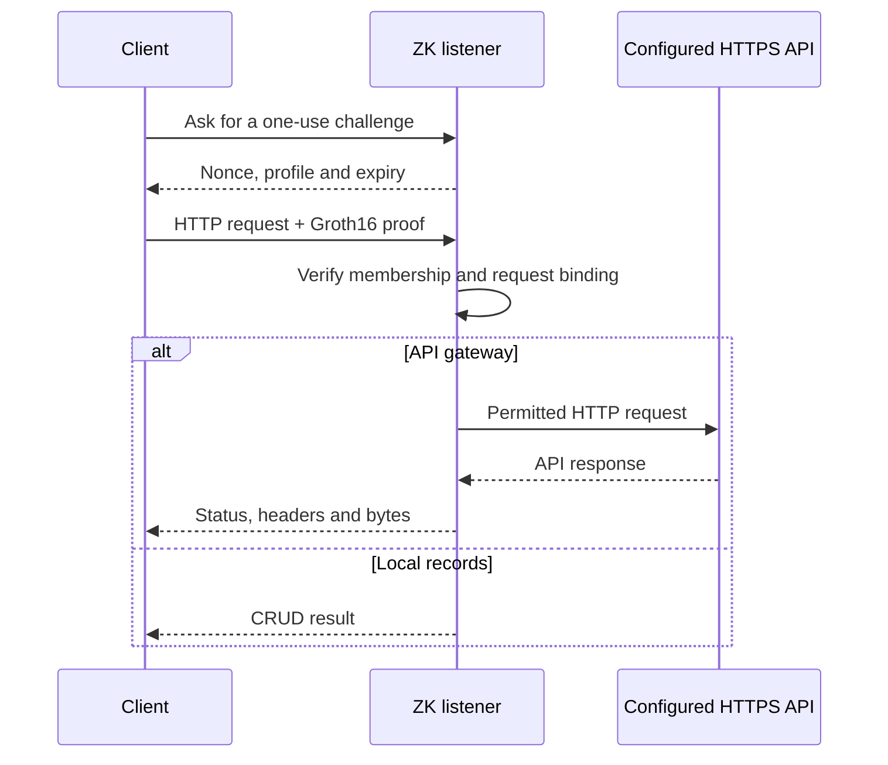

# zkWeb

**Experimental ZK authorization for web requests.**

A client proves it belongs to an authorized group. The listener verifies that
proof against the request, then forwards it to a configured HTTPS API or
executes local record CRUD. The member's secret, index and membership path
stay on the client.



The circuit uses BN254 Groth16 and Poseidon Merkle membership. API authorization
binds the upstream origin, method, exact path/query, selected headers and body to
the pinned profile, listener instance and fresh challenge. A privately blinded
tag changes for each proof, including when a request context repeats. The
listener consumes a challenge before verification.

**The listener and upstream see request contents. Local records are plaintext.**
This stage protects the authorization credential. FHE for computing over hidden
contents is a later, separate experiment.

## Run the listener

Install Go, Rust 1.99 and the build requirements in the
[headless client guide](research-mixnet/README.md), then:

```sh
cd research-mixnet
make build build-zk

# Trusted offline setup; use a fresh output directory.
./bin/zkweb zk-setup --output /tmp/zkweb-demo --members 4

# Give the listener only server/, never the complete setup directory.
./bin/zkweb zk-listen \
  --server-dir /tmp/zkweb-demo/server \
  --state-file /tmp/zkweb-records.json \
  --listen 127.0.0.1:0
```

In another terminal, use the port from the listener's READY URL:

```sh
ZKWEB_CLIENT_DIR=/tmp/zkweb-demo/client-0
ZKWEB_LISTENER_URL=http://127.0.0.1:PORT

./bin/zkweb zk-request --client-dir "$ZKWEB_CLIENT_DIR" --url "$ZKWEB_LISTENER_URL" \
  --method POST --key note --data 'hello'
./bin/zkweb zk-request --client-dir "$ZKWEB_CLIENT_DIR" --url "$ZKWEB_LISTENER_URL" \
  --method GET --key note
./bin/zkweb zk-request --client-dir "$ZKWEB_CLIENT_DIR" --url "$ZKWEB_LISTENER_URL" \
  --method PUT --key note --data 'updated'
./bin/zkweb zk-request --client-dir "$ZKWEB_CLIENT_DIR" --url "$ZKWEB_LISTENER_URL" \
  --method DELETE --key note
```

`--data-file` sends exact binary bytes; an empty value is valid. Results contain
an HTTP status and `body_base64`. Every request gets a new proof and challenge;
mutations are never automatically retried after an uncertain outcome.

The client uses a [compact binary protocol](docs/compact-zk-client-server.md):
72-byte challenges, 192 raw authorization bytes, and only the operation metadata
and payload required by the server. CLI output remains JSON. Use `--wire legacy`
explicitly for an older listener; failed requests never trigger a downgrade.

The [listener guide](docs/zk-listener.md) covers provisioning, the proof
statement, HTTP behavior and recovery. The implementation lives in
[research-mixnet/zk-listener](research-mixnet/zk-listener/).

## Authorize an external API request

Start the listener in gateway mode using the same group profile. Replace the
example origin and path scope with an API your group is allowed to use:

```sh
./bin/zkweb zk-listen --server-dir /tmp/zkweb-demo/server \
  --upstream https://api.example.com --upstream-path-prefix /v1/ \
  --allow-methods GET,HEAD,POST,PUT,PATCH,DELETE,OPTIONS --listen 127.0.0.1:0

./bin/zkweb zk-api --client-dir /tmp/zkweb-demo/client-0 \
  --url http://127.0.0.1:PORT --upstream https://api.example.com \
  --method POST --path /v1/items --header 'Content-Type: application/json' \
  --data '{"name":"example"}'
```

The gateway forwards only after proof verification. It pins a configured HTTPS
origin, validates TLS, enforces method/path policy, and never follows redirects
or retries automatically. Upstream status, cleaned headers and binary bytes are
returned as structured data. See the [API gateway guide](docs/zk-api.md) for
gateway-held credentials, 1 MiB files, delivery failures and local TLS setup.

## Current experimental boundary

| Area | Current behavior |
| --- | --- |
| Authorization | 1–16 members, default four; listener receives only a verifying key and public profile |
| Records | Persistent binary CRUD; values up to 64 KiB; at most 1024 live records |
| External APIs | Seven HTTP methods, signed caller headers, 1 MiB request/response bodies; configured HTTPS origin and path scope |
| Access | Every authorized member can access every record in the group |
| Setup | Trusted offline provisioning; the provisioner knows member secrets and can impersonate members |
| Visibility | Request contents, records, IP, timing, sizes and shared profile remain visible |
| Deployment | Numeric loopback HTTP; remote authenticated deployment is separate work |

This is a prototype with a single-party setup, rather than a production
multiparty ceremony. Filesystem modes and separate processes do not isolate
credentials from an administrator of the same machine.

## Experimental feature tracks

| Track | Direction |
| --- | --- |
| ZK listener | Working proof → verification → persistent CRUD loop; strengthen service integration |
| Credential lifecycle | Experiment with enrollment, rotation, revocation and group updates |
| External API requests | Working experimental HTTPS gateway with origin, method, path/query, headers and body bound to authorization |
| Encrypted computation | Resume FHE after the authorization loop; keep its privacy model explicit |

Other independent tools remain available: [Tor/SOCKS HTTPS](docs/local-https-client.md),
[local Sphinx transport](research-mixnet/README.md),
[offline TLSNotary verification](docs/response-verification.md) and the
[earlier FHE query prototype](docs/private-requests.md).

## Build and verify

From `research-mixnet/`:

```sh
make test-zk   # Real proofs, record listener and HTTPS API gateway integration
make test-zk-live # Opt-in real HTTPS APIs: GitHub reads and httpbingo methods
make test     # Go race regression suite
make vet
```

The ZK backend is an independent Rust workspace with no TFHE, wallet-funding or
chain-oracle dependency. `make build` supplies command wrappers; `make build-zk`
installs the optional proof backend beside `zkweb`.

The live tests use fresh credentials for two group members, check public API
responses and seven HTTP methods, and reject replayed and tampered
authorization. They use no API tokens. See the
[live-test instructions and recorded results](docs/zk-api.md#live-public-api-test).

Read the [architecture](research-mixnet/ARCHITECTURE.md) and
[implementation research](docs/web-request-research.md) for the broader plan.
Inherited wallet, billing and operator documentation is preserved in the
[upstream zkAPI reference](docs/upstream-zkapi.md).
